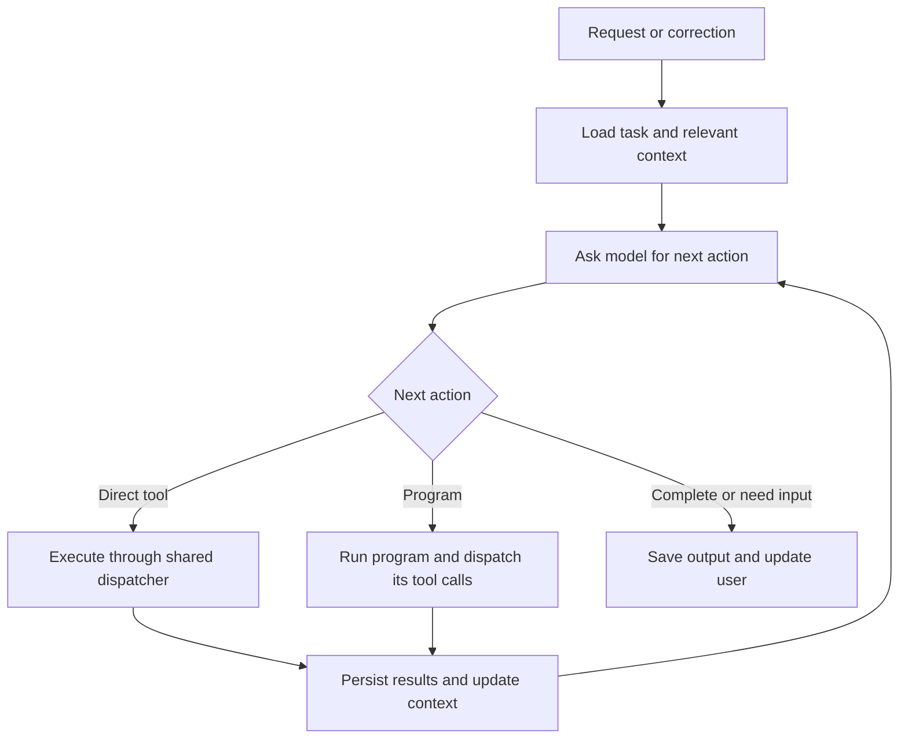

# Work Agent Blueprint Draft

**Review draft · November 21, 2026**

Build a persistent, general work agent with an owned execution loop, programmatic tool calling, durable artifacts, and lightweight learning. Codex builds the application. “Work Agent” is a working name for the fresh project.

Two principles shape the MVP: **get useful work running early and improve from real failures; let the agent recover, retain useful methods, and suggest concrete improvements.** Every additional component should earn its place by improving work the agent actually needs to do.

# Product and MVP

The agent should feel like a work partner you can give an outcome to: research a question, work through files, calculate something, produce a useful artifact, or continue an existing assignment. You can correct it while it works and return to the same work later.

The first version supports a single user and one active assignment, with independent tool calls running in parallel when useful. It has a simple conversation interface, visible progress, file input, saved outputs, and a stop control. Its tools cover search and page retrieval, reading and editing workspace files, and running code or commands.

**Generality belongs in the first working version.** Research, file analysis, and artifact creation use the same loop and tools. Example tasks are demonstrations of that capability; they do not become hardcoded workflow types.

MVP learning includes saving a verified method or helper and retrieving it in a fresh, related assignment. A correction specific to one assignment stays with that work. Reliable recall across every possible task is a longer-term improvement.

# Architecture

Package the web app and background runner in one Docker image and start them as one Docker Compose service. The runner operates independently of the browser connection. One capable model handles reasoning. The application owns tool execution, persistence, and user interaction. Use the same Dockerfile and Compose configuration for development, testing, and the initial single-host EC2 deployment.

| Component | Responsibility |
| --- | --- |
| Conversation interface | Submit work and files, show progress and artifacts, accept corrections, stop or continue a run. |
| Owned agent loop | Assemble relevant context, call the model, dispatch tools, process results, and decide when the run completes or waits. |
| Shared tool dispatcher | Execute direct calls and calls originating inside a program through the same tool implementations. |
| Workspace execution | Use bounded tools for initial calculations. When arbitrary generated scripts are needed, run them in a separate disposable sandbox with access to that run’s staged files only. |
| Durable state | Store conversation and run events in SQLite; keep inputs, outputs, helpers, and learning notes on durable disk. |

These are responsibilities within a small application, not separate services. The benefit is direct control over behavior and learning. The cost is owning tool semantics, continuation, context assembly, and recovery. Reuse established clients and execution components wherever they satisfy those responsibilities.

## Execution flow

The same model can plan, execute, inspect a result, and change its approach. A short plan is useful when the task warrants one. It does not require a permanent planner, executor, and critic hierarchy.

At each continuation, incorporate new user input before selecting more work. Record tool results and failures as observations so the model can respond to what actually happened.

# Programmatic tool calling

Programmatic tool calling, or PTC, lets the model write code that coordinates several tool operations. Keep direct calls available for a single operation or a step that needs fresh judgment. Use programs for predictable batches, filtering, joins, and calculations. Preserve source references and artifact identities when reducing results.

**Proposed first implementation: OpenAI Responses with hosted PTC, while we own the outer loop.** OpenAI runs the orchestration JavaScript; the application executes its own tool functions. The hosted runtime has no general filesystem, shell, Node.js, or direct network access, so those capabilities remain workspace tools. Preserve native response items, call IDs, and caller metadata during continuation. A completed program alone does not mean the assistant has finished. [OpenAI PTC documentation](https://developers.openai.com/api/docs/guides/tools-programmatic-tool-calling)

For example, the agent could retrieve several independent sources, extract comparable fields, and return a compact table to reason over. It can then make a direct call to inspect a confusing source before writing its recommendation.

Hosted PTC is a provider choice. If immediate support for other model providers is essential, a local program executor may be preferable, with additional runtime work. Keep that as an explicit tradeoff; an owned loop does not automatically provide identical behavior across providers.

# Durable work and context

Keep the complete run record separate from the context sent to the model. Each continuation receives the current request, relevant conversation, recent observations, artifact references, and useful lessons. Older detail remains retrievable. Compress context when needed while retaining the original history and provider continuation data.

Preserve original inputs and give each run its own working directory. Tools and scripts write draft outputs there. Only the application can publish a revision to the user’s saved artifact. At publication, check in one atomic operation that the run is active, the instructions still match those used to produce the draft, and the saved artifact is at the revision the agent read. If the user has edited the file or corrected the task, keep their version and let the agent reconcile its draft with the current work. After Stop, a late result stays unpublished.

Closing the browser should leave the server working. If the application process crashes, preserve completed steps and artifacts, mark the run interrupted, and offer continuation. Manual continuation is sufficient initially. If an external action may have succeeded before the crash, inspect its outcome before repeating it. Mount a named volume at `/data` for SQLite, uploads, outputs, helpers, and learning notes. Start the app from a clean checkout with `docker compose up --build -d`. After saving an artifact, recreate the service with the same volume, reopen the artifact, and submit a fresh assignment. Preserve the volume across deployments.

A stop request prevents further tool dispatch and stale output commits; report work that already completed. Add practical limits on model turns, tool runtime, and total run duration, and record usage. Keep credentials and application internals outside the agent's writable task workspace. These are small runtime responsibilities, implemented through existing execution and deployment mechanisms.

# Learning and self-improvement

Learning means useful experience changes subsequent behavior. In this design, that happens through context, procedures, and code. It does not update the foundation model's weights.

## Recover during the current task

When a tool fails or a result looks wrong, the agent inspects the evidence, forms a specific hypothesis, tries an appropriate alternative, and checks the result. It then continues toward the user's outcome. Repeating the same unsuccessful action without new information is not progress.

For example, a CSV import drops leading zeros from account identifiers. The agent checks the source, preserves identifier columns as text, explicitly converts numeric measures, and reruns the calculation. If the cause is still uncertain, it retains that uncertainty rather than treating a guess as a discovered rule.

## Retain useful experience

Start with a small learning note and a helpers directory, accessed through the existing file tools. A note can point to a longer procedure or the run where it was learned. Use a short index and ordinary file search as the collection grows.

Useful material includes explicit user preferences, project conventions, successful approaches, and verified recoveries. Save it when it is likely to help again; a mandatory reflection after every task would add noise.

A retained lesson should make its scope and supporting observation understandable. For the CSV example:

> **Scope:** Account exports using this identifier format.  
> **Observation:** Automatic numeric parsing removed leading zeros from account IDs.  
> **Working method:** Preserve the ID field as text and convert only the numeric measures needed for calculation.  
> **Evidence:** The corrected import matched the original IDs and the checked totals.

At the start of related work, load the short index and let the agent retrieve the relevant note or helper. Current instructions and current evidence take precedence. The agent can revise or remove outdated lessons; the user can inspect, correct, or delete them.

Anthropic's memory research supports testing hypotheses before retaining them and shows that, in its reported experiments, restricting memory to failures could reduce its benefit. Results also varied by model. OpenAI's Agents SDK documents lessons stored in files separately from conversation history. We can borrow those patterns in our own loop. [Anthropic memory research](https://www.anthropic.com/research/components-of-agent-memory) · [OpenAI agent memory](https://openai.github.io/openai-agents-python/sandbox/memory/)

## Improve helpers and the application

Within its authorized workspace, the agent may create or improve a reusable helper, check it against the current task, and retain it for future use. On reuse, it still checks that the helper fits the new inputs.

When the obstacle belongs to the application itself, the agent records a concrete improvement for Codex:

- **Observed problem:** What happened, with the relevant error or run reference.

- **Reproduction:** The smallest example that exposes the problem.

- **Current workaround:** How the task can proceed, if possible.

- **Proposed change:** The specific tool or runtime behavior to improve.

- **Verification:** What should succeed after the repair.

Keep these in a short improvement list. If the fix is straightforward, the agent can prepare a patch in a development checkout for the normal Codex workflow. Core runtime changes are versioned application work; live runtime rewriting is a later capability.

Fixing the user's immediate problem comes first. Raising an improvement should not turn the task into an open-ended investigation.

## Evidence that learning works

A written lesson is a candidate improvement. Its value appears when subsequent work improves: the same correction carries forward, a helper works on a related input, or a previously encountered problem requires less investigation.

Keep a few real examples with their outcomes and rough effort or tool usage. Compare like-for-like work where practical, with the model and task conditions recorded. A faster run alone may reflect an easier input or a different model. Start with these examples before investing in a scoring system or automated optimization.

The initial learning tradeoff is simple: useful memory saves work, while incorrect or oversized memory can waste it. Keep notes scoped, retrievable, and easy to amend.

# A complete MVP journey

Use this journey to review whether the product is useful:

1. **Give it real work.** Supply several supplier quotes and relevant product documents. Ask for a cost comparison, missing assumptions, and a sourced recommendation.

2. **Let it work through the materials.** The agent reads the files, retrieves any necessary public sources, and writes a small calculation script.

3. **Recover from an import error.** One supplier export uses part numbers with leading zeros. When the import drops them, the agent checks the source, reads the identifiers as text, and verifies the part numbers and totals. It saves the working method for related exports.

4. **Correct the task while it runs.** Clarify that a delivery charge applies to every shipment. The agent updates the calculation and keeps that convention scoped to this comparison.

5. **Leave and return.** Closing the browser does not stop the assignment. Returning shows the saved progress, comparison table, and recommendation with assumptions and source references.

6. **Continue the original assignment.** Add another quote in the same conversation. The agent updates the comparison using the clarified delivery terms and preserves a note the user added to the saved recommendation.

7. **Test learning in a fresh assignment.** Start a new conversation with differently formatted quotes, leading zeros in part numbers, and freight charged once per order. Give the agent access to its saved methods and new inputs, with the earlier conversation left out. The run record should show which note or helper it retrieved. Check that the part numbers match the new source and that the totals match an independent calculation using the new freight terms. If the work exposes a repeatable application defect, capture the repair proposal for Codex.

Markdown and CSV are sufficient initial outputs for this journey. Use existing libraries when a richer format adds value.

Use the same loop for an unrelated request, such as a sourced meeting brief. Open the saved brief and follow its references to check that the general tools also support research.

# Build sequence

The MVP comprises the first two increments and begins with assignments the user initiates. The third increment tests whether the user can hand the agent one ongoing responsibility.

| Increment | Working result | What we learn |
| --- | --- | --- |
| 1. Useful general agent | Compare two quotes end to end with direct tool calls. Then enable hosted PTC for a batch of quote reads and produce an unrelated sourced brief through the same loop. Save the outputs, run history, and a small learning note. | Do both tool paths preserve totals and source references? Can the same tools handle an unfamiliar research request? |
| 2. Continuity and demonstrated learning | Support browser-independent execution, corrections, Stop, manual continuation, and user edits. Demonstrate lesson or helper retrieval in a fresh assignment. Record concrete repair proposals when defects recur. | Can the user return to accurate work and see a verified method applied where it fits? |
| 3. One ongoing responsibility | Run one user-requested recurring task using a persisted next-run time and the existing runner. | Does the agent return something useful at the agreed time without another prompt? |

Build only the scheduling needed for that first recurring responsibility. Add integrations or concurrency in response to actual workloads.

# How Codex should build it

Keep this blueprint and one short current implementation brief as the working plan. Each brief names the user-visible outcome, the bounded change, and the example that will demonstrate it.

Codex should complete a usable slice, run the real example, inspect the result, and report what works and what still fails. When a problem appears, identify whether its cause is the model, context, tool interface, data, or application code. Repair that cause before adding instructions or architecture.

Keep small regression cases for interrupted work and late results. Start a slow calculation, edit its target artifact, and let the calculation finish. Reopen the artifact and verify the user’s edit survived. Repeat with a task correction and with Stop to check that a result computed under old instructions or by a stopped run cannot become current. Keep model and dependency versions stable when comparing a repair.

Reuse old WorkAgent code only where a module directly helps this first product and its behavior can be checked. Candidate value includes artifact handling, preservation of edits, and useful execution utilities. Treat every reuse as a small decision.

**First Codex assignment.** Build the shortest path from a request and two uploaded supplier quotes to a saved comparison. Use the owned loop and direct file and calculation tools. Deliver a CSV and a short Markdown recommendation. Reopen both through the interface, compare the totals against an independent calculation, trace each price to its source row or page, and identify a missing assumption that could change the recommendation. Use the quotes as sample inputs to general tools. Once this works, finish increment 1 by exercising hosted PTC on the same batch and running the unrelated research request.

# What it can become

After the MVP, the agent can take on recurring work, gain integrations, and build a useful collection of scoped methods. Repeated, concrete application problems can lead to patches that Codex implements and verifies through the normal development workflow.

The later Space concept gives ongoing work a home. For example, “Create a space for my todo lists” could turn an existing list into a persistent view with its data, related conversations, artifacts, preferences, and optional recurring responsibilities. The agent continues using the same underlying files, tools, and loop.

Preserving artifact identity and relevant context now supports that direction. The Space interface, custom document editors, broad multi-agent coordination, a universal model router, a dedicated memory service, and automatic live self-modification remain outside the first build.

# Proposed defaults for review

The direction carried forward is the owned loop, PTC, lean iteration, learning, Codex as builder, and Spaces later. These implementation defaults remain open to review:

| Decision | Proposed default | Main tradeoff |
| --- | --- | --- |
| Model and PTC | One capable OpenAI model through Responses, with hosted PTC. | Less program-runtime work initially; another provider may need a different PTC path. |
| Deployment | One Compose service on EC2 for a single user and one active assignment. SQLite and workspace files share a persistent volume. | The same container setup can be tested before deployment. The host needs Docker with Compose and durable storage. |
| Initial interface and artifacts | Simple conversation, progress, files, and Markdown/CSV outputs; richer formats through libraries as needed. | Fast access to useful work; fewer polished editing features. |
| Learning autonomy | Automatically maintain scoped notes and workspace helpers; prepare application fixes for the normal Codex workflow. | Useful adaptation immediately; changes to the core application follow its versioned development process. |
| Crash recovery | Save completed work, mark interrupted runs, and offer manual continuation. | Less recovery machinery initially; some interruptions need user resumption. |

Start with Python, FastAPI, SQLite, and server-rendered HTML. Install application dependencies in the image and supply runtime credentials separately. On the first EC2 host, bind the UI to localhost for access through an SSH tunnel. Codex CLI can run on the host for maintenance. Compose starts and restarts the application independently of the CLI.

The first decision to judge in use is whether this small agent can do valuable work and improve on the next attempt. Expand the architecture in response to what that work reveals.
